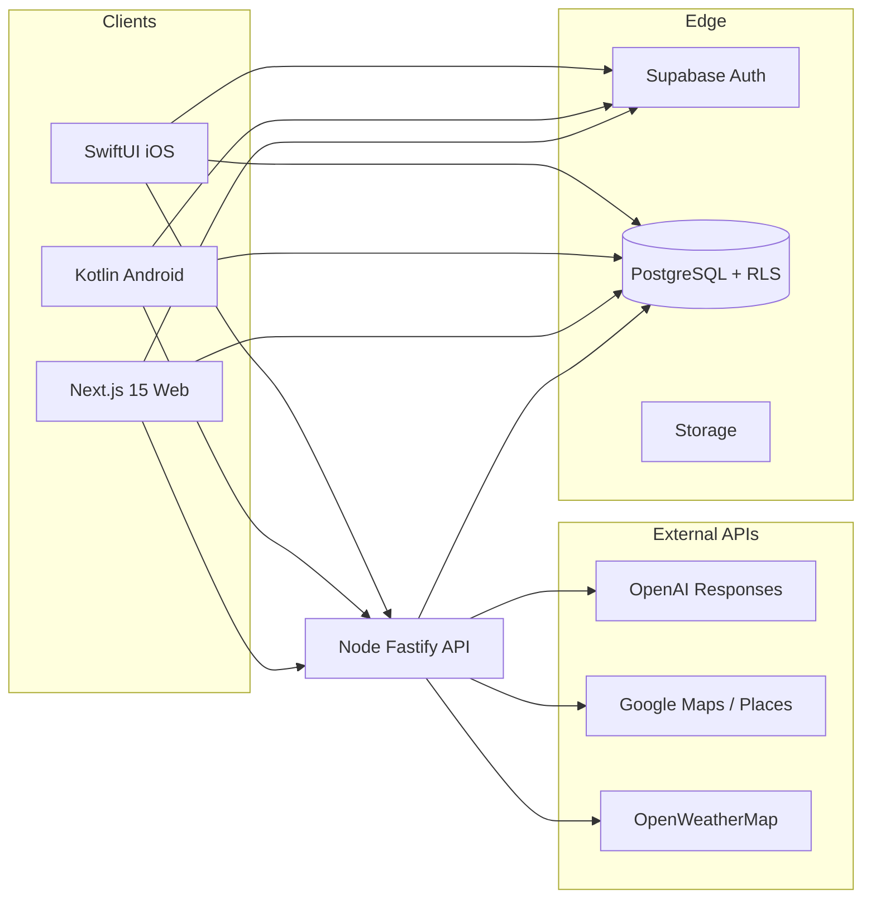

# WanderTale — Kiến trúc

## Luồng tạo chuyến (generate)

1. Client đã đăng nhập Supabase → gửi `access_token` tới API.
2. API xác minh JWT người dùng qua **`supabase.auth.getUser(access_token)`** (service role), không cần biến `SUPABASE_JWT_SECRET` trên backend.
3. API gọi tuần tự / song song: Geocoding, Places, Forecast, Directions (traffic), đọc voucher từ Supabase.
4. OpenAI Responses API trả JSON itinerary theo schema.
5. Ghi `trips`, `trip_days`, `trip_activities`, `weather_snapshots`.

## Đồng bộ session Web ↔ Mobile

Cùng một Supabase project + cùng user email/password → cùng `auth.users`. Mỗi client giữ session riêng (cookie web, Android local storage, iOS Keychain/UserDefaults); dữ liệu chuyến (`trips`) dùng chung qua `user_id`.

## Monorepo

- `apps/web` — UI chính, SSR middleware Supabase.
- `mobile` — Android native Kotlin + Jetpack Compose.
- `apps/app-ios` — iOS native Swift + SwiftUI.
- `backend` — Fastify, tích hợp API bên thứ ba.
- `shared` — kiểu TypeScript dùng chung.
- `supabase` — migration + seed.

## Roadmap production-scale

- Rate limit / queue cho `/trips/generate`.
- Edge Functions cho webhook Stripe.
- pgvector: embedding từ summary chuyến để gợi ý tương tự.
- CDN cho static map; Places Details cho popular times khi có quota.
- Quan sát: OpenTelemetry + logging tập trung.
- E2E (Playwright / Detox) cho luồng auth + tạo chuyến.
